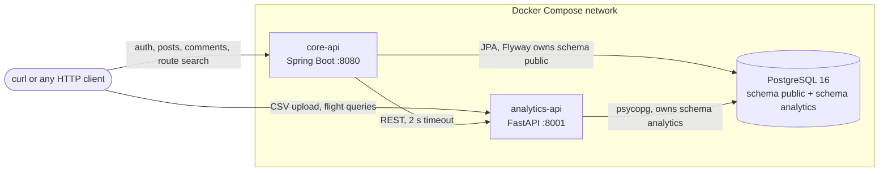

# TravelOps

[](https://github.com/Zzz23hao/TravelOPs/actions/workflows/ci.yml)

TravelOps is a two-service backend for travel content and flight-route analysis:

- **core-api** (Java 17, Spring Boot 3.3): accounts with JWT authentication, travel posts with
  pagination and keyword search, comments, owner-only edits, and a route-search endpoint that
  calls the analytics service and logs every search.
- **analytics-api** (Python 3.12, FastAPI, Pandas): flight CSV import with per-row validation,
  Pandas flight queries, and airport route search (Dijkstra by distance or price, BFS by number
  of flights).
- **PostgreSQL 16**, shared by both services, with one schema per service.

Everything runs locally with one `docker compose` command. Nothing is deployed; see
[What is real and what is not](#what-is-real-and-what-is-not).

## Architecture



A route search goes through the Java service:

1. `GET /api/routes/shortest?from=YYZ&to=LAX` with a JWT reaches core-api.
2. core-api calls `GET http://analytics-api:8001/routes/shortest?from=YYZ&to=LAX`.
3. analytics-api loads the flights, builds the graph and runs Dijkstra.
4. core-api records the search in `route_search_logs` and returns the route, a 404 if no
   route exists, or a 503 if the analytics service failed or timed out.

## Tech stack

| Area | Choice |
|---|---|
| Core API | Java 17, Spring Boot 3.3.13, Spring Security 6, Spring Data JPA, Flyway, jjwt 0.12.6, Maven wrapper |
| Analytics API | Python 3.12, FastAPI 0.141, Pydantic 2.13, Pandas 3.0, psycopg 3.3 |
| Database | PostgreSQL 16 |
| Tests | JUnit 5, Mockito, MockMvc, MockRestServiceServer; pytest |
| Delivery | Docker Compose, GitHub Actions |

All dependency versions are pinned in `travelops-core-api/pom.xml` and
`travelops-analytics-api/requirements*.txt`.

## Quick start

Requires Docker with Compose v2. Ports 8080 and 8001 must be free.

```bash
git clone https://github.com/Zzz23hao/TravelOPs.git
cd TravelOPs
cp .env.example .env
docker compose up --build -d
```

The first build downloads Maven and pip dependencies and takes a few minutes. The stack is
ready when both of these answer:

```bash
curl http://localhost:8001/health
curl "http://localhost:8080/api/posts?size=1"
```

Stop with `docker compose down`. Add `-v` to also delete the database volume and start over.

Before sharing the stack with anyone, replace `JWT_SECRET` in `.env` with your own value
(`openssl rand -base64 48`).

## Environment variables

Set in `.env` (copied from `.env.example`; `.env` is gitignored):

| Variable | Used by | Purpose |
|---|---|---|
| `POSTGRES_DB`, `POSTGRES_USER`, `POSTGRES_PASSWORD` | all three | Database name and credentials. Keep the password URL-safe (letters, digits, `-`, `_`). |
| `JWT_SECRET` | core-api | HMAC key that signs JWTs. At least 32 bytes, or core-api refuses to start. |

Derived in `docker-compose.yml`, using Compose service names as hostnames:

| Variable | Service | Value |
|---|---|---|
| `DATABASE_URL`, `DATABASE_USERNAME`, `DATABASE_PASSWORD` | core-api | `jdbc:postgresql://postgres:5432/<db>` and the credentials above |
| `ANALYTICS_API_URL` | core-api | `http://analytics-api:8001` |
| `DATABASE_URL` | analytics-api | `postgresql://<user>:<password>@postgres:5432/<db>` |

Neither service has a fallback such as `localhost`: a missing variable stops startup instead of
silently connecting to the wrong place.

## API walkthrough

Run these from the repository root after the quick start, in order. Every command is plain
`curl`; tokens and ids are captured with `sed`, so nothing else needs to be installed.

### Accounts

```bash
# Register two users
curl -s -X POST http://localhost:8080/api/auth/register -H "Content-Type: application/json" \
  -d '{"email":"alice@example.com","password":"Password123!","name":"Alice"}'
curl -s -X POST http://localhost:8080/api/auth/register -H "Content-Type: application/json" \
  -d '{"email":"bob@example.com","password":"Password123!","name":"Bob"}'

# Log in; the response is {"access_token":"...","token_type":"bearer"}
ALICE=$(curl -s -X POST http://localhost:8080/api/auth/login -H "Content-Type: application/json" \
  -d '{"email":"alice@example.com","password":"Password123!"}' | sed -E 's/.*"access_token":"([^"]+)".*/\1/')
BOB=$(curl -s -X POST http://localhost:8080/api/auth/login -H "Content-Type: application/json" \
  -d '{"email":"bob@example.com","password":"Password123!"}' | sed -E 's/.*"access_token":"([^"]+)".*/\1/')

# Current user: 200 with a token, 401 without one
curl -s http://localhost:8080/api/users/me -H "Authorization: Bearer $ALICE"
curl -s http://localhost:8080/api/users/me
```

### Travel posts

```bash
# Create (login required); the author is taken from the token
POST_ID=$(curl -s -X POST http://localhost:8080/api/posts -H "Authorization: Bearer $ALICE" \
  -H "Content-Type: application/json" \
  -d '{"title":"Three Days in Vancouver","content":"Day 1: Stanley Park...","destination_city":"Vancouver","destination_country":"Canada"}' \
  | sed -E 's/^\{"id":([0-9]+).*/\1/')

# List (public): page, size (1-100), keyword (title, content or city), destination (exact city),
# sort = createdAt_desc (default) or createdAt_asc
curl -s "http://localhost:8080/api/posts?page=0&size=20&keyword=vancouver&sort=createdAt_desc"
curl -s "http://localhost:8080/api/posts?destination=Vancouver"

# Read one (public); a missing id is 404 POST_NOT_FOUND
curl -s http://localhost:8080/api/posts/$POST_ID
curl -s http://localhost:8080/api/posts/999999

# Update: only the author may change a post. Bob gets 403, Alice gets 200.
curl -s -X PATCH http://localhost:8080/api/posts/$POST_ID -H "Authorization: Bearer $BOB" \
  -H "Content-Type: application/json" -d '{"title":"Hijacked"}'
curl -s -X PATCH http://localhost:8080/api/posts/$POST_ID -H "Authorization: Bearer $ALICE" \
  -H "Content-Type: application/json" -d '{"title":"Four Days in Vancouver"}'
```

### Comments

```bash
# Comment (login required) and list (public)
COMMENT_ID=$(curl -s -X POST http://localhost:8080/api/posts/$POST_ID/comments \
  -H "Authorization: Bearer $BOB" -H "Content-Type: application/json" \
  -d '{"content":"Great itinerary!"}' | sed -E 's/^\{"id":([0-9]+).*/\1/')
curl -s http://localhost:8080/api/posts/$POST_ID/comments

# Only the comment's author may delete it: Alice gets 403, Bob gets 204
curl -s -o /dev/null -w "%{http_code}\n" -X DELETE http://localhost:8080/api/comments/$COMMENT_ID \
  -H "Authorization: Bearer $ALICE"
curl -s -o /dev/null -w "%{http_code}\n" -X DELETE http://localhost:8080/api/comments/$COMMENT_ID \
  -H "Authorization: Bearer $BOB"
```

### Flight data (analytics-api)

```bash
# Upload the sample CSV: 31 rows, of which 7 are deliberately malformed
curl -s -F "file=@travelops-analytics-api/data/sample_flights.csv" \
  http://localhost:8001/api/data/flights/upload
# {"job_id":"job_001","filename":"sample_flights.csv","total_records":31,"valid_records":24,"invalid_records":7,"status":"completed"}

# Pandas queries; sort_by = price (default) or duration_minutes
curl -s "http://localhost:8001/api/data/flights?source=YYZ&sort_by=price"
curl -s "http://localhost:8001/api/data/flights/search?from=YYZ&to=ORD"
curl -s "http://localhost:8001/api/data/flights/domestic"
curl -s "http://localhost:8001/api/data/flights/international?sort_by=duration_minutes"

# Route search directly on the analytics service
curl -s "http://localhost:8001/routes/shortest?from=YYZ&to=LAX"
```

Each rejected row is logged with its reasons: `docker compose logs analytics-api | grep Rejected`.

### Route search through the core API

```bash
# Login required: every search is logged against the user
curl -s "http://localhost:8080/api/routes/shortest?from=YYZ&to=LAX" -H "Authorization: Bearer $ALICE"
curl -s "http://localhost:8080/api/routes/cheapest?from=YYZ&to=LAX" -H "Authorization: Bearer $ALICE"
curl -s "http://localhost:8080/api/routes/min-transfers?from=YYZ&to=LAX" -H "Authorization: Bearer $ALICE"

# No route exists: 404 NO_ROUTE_FOUND, passed through from the analytics service
curl -s "http://localhost:8080/api/routes/shortest?from=YYZ&to=MEX" -H "Authorization: Bearer $ALICE"
```

With the sample data the three searches return three different routes for Toronto to Los Angeles:

| Search | Route | Distance | Price | Transfers |
|---|---|---|---|---|
| shortest | YYZ → ORD → LAX | 3507 km | 420 | 1 |
| cheapest | YYZ → JFK → DEN → LAX | 4595 km | 280 | 2 |
| min-transfers | YYZ → ATL → LAX | 4300 km | 470 | 1 |

Stop the analytics service and search again to see the failure path, then bring it back:

```bash
docker compose stop analytics-api
curl -s "http://localhost:8080/api/routes/shortest?from=YYZ&to=LAX" -H "Authorization: Bearer $ALICE"
# {"error":"ROUTE_SERVICE_UNAVAILABLE","message":"Route search service is temporarily unavailable. Please try again later."}
docker compose start analytics-api
```

Every search, including failed ones, is in the search log:

```bash
docker compose exec postgres psql -U travelops -d travelops \
  -c "SELECT search_type, source_airport, destination_airport, outcome, latency_ms FROM route_search_logs ORDER BY id"
```

(Use your own `POSTGRES_USER` and `POSTGRES_DB` if you changed them in `.env`.)

### Clean up the demo post

```bash
curl -s -o /dev/null -w "%{http_code}\n" -X DELETE http://localhost:8080/api/posts/$POST_ID \
  -H "Authorization: Bearer $ALICE"
```

### Errors

Both services return errors in one shape: `{"error": "<CODE>", "message": "<text>"}`.

| Status | Codes |
|---|---|
| 400 | `VALIDATION_FAILED`, `INVALID_PARAMETER`, `MALFORMED_REQUEST`, `INVALID_CSV` |
| 401 | `UNAUTHORIZED` (missing, invalid or expired token), `INVALID_CREDENTIALS` |
| 403 | `FORBIDDEN` (not the author) |
| 404 | `POST_NOT_FOUND`, `COMMENT_NOT_FOUND`, `USER_NOT_FOUND`, `NO_ROUTE_FOUND`, `AIRPORT_NOT_FOUND`, `NOT_FOUND` |
| 409 | `EMAIL_ALREADY_REGISTERED` |
| 413 | `FILE_TOO_LARGE` (CSV over 10 MB) |
| 503 | `ROUTE_SERVICE_UNAVAILABLE` (core-api), `DATABASE_UNAVAILABLE` (analytics-api) |

## Database schema

One PostgreSQL database, one schema per service; neither service writes to the other's tables.

**Schema `public`**, versioned by Flyway in `travelops-core-api/src/main/resources/db/migration`:

| Table | Key columns and constraints |
|---|---|
| `users` | `email` UNIQUE (stored lower-case), `password_hash` (BCrypt), `name`, `role` |
| `posts` | `user_id` FK → users, `title`, `content`, `destination_city`, `destination_country`; index `(destination_city, created_at)` |
| `comments` | `post_id` FK → posts ON DELETE CASCADE, `user_id` FK → users, `content`; index `(post_id, created_at)` |
| `route_search_logs` | `user_id` FK → users, `source_airport`, `destination_airport`, `search_type`, `outcome`, `result_summary`, `latency_ms` |

**Schema `analytics`**, created by analytics-api at startup from `travelops-analytics-api/app/storage/schema.sql`:

| Table | Key columns and constraints |
|---|---|
| `data_import_jobs` | `filename`, `status` (processing, completed, failed), record counts |
| `airports` | `airport_code` UNIQUE, `city`, `country` |
| `flights` | `flight_id` UNIQUE, source and destination FK → airports, `distance_km`, `duration_minutes`, `price` with CHECK > 0, CHECK source ≠ destination, `import_job_id` FK |

## Running the tests

Both suites run without a database or a running stack.

```bash
cd travelops-core-api
./mvnw test
```

Needs JDK 17 or newer; the Maven wrapper downloads Maven itself. 70 tests, including one that
starts a deliberately slow local HTTP server to prove the 2-second timeout fires.

```bash
cd travelops-analytics-api
python3.12 -m venv .venv
source .venv/bin/activate
pip install -r requirements-dev.txt
pytest
```

59 tests. `pytest.ini` turns warnings into errors.

GitHub Actions runs both suites on every push and pull request
([.github/workflows/ci.yml](.github/workflows/ci.yml)). A failing test fails its job and turns
the run red. A red run only blocks merging when branch protection on `main` requires these
checks; that is not enabled in this repository.

## Design decisions

- **Two services, one per job.** Java handles accounts, permissions and transactional content;
  Python handles CSV parsing, Pandas and graph search. The cost is a network call that can fail,
  which is why the integration has a timeout, typed error mapping and a log.
- **Each service owns its own schema.** Flyway refuses to migrate a non-empty schema it has no
  history for. If both services used `public`, whichever started first could stop the other's
  Flyway. Separate schemas remove that race and make ownership explicit.
- **Flyway owns the core schema; Hibernate only validates it** (`ddl-auto: validate`). The tables
  and indexes are reviewable SQL, and an entity that drifts from the schema stops startup.
- **Stateless JWT.** The token's subject is the user id; the filter builds the principal without
  a database query. A missing or invalid token is rejected as **401** by the security entry point,
  before any controller runs. Ownership is a business rule checked in the service, so a valid
  user editing someone else's post gets **403**.
- **N+1 guarded with entity graphs.** Post and comment listings fetch their authors in the same
  query. With SQL logging on, one page of posts is one `SELECT ... JOIN users`.
- **"No route" is an answer, not a failure.** core-api passes the analytics service's
  `NO_ROUTE_FOUND` and `AIRPORT_NOT_FOUND` through as 404. Timeouts, refused connections, 5xx
  responses, unreadable bodies and unknown error codes all become 503 `ROUTE_SERVICE_UNAVAILABLE`.
- **Timeouts are explicit.** Connect and read timeouts are both 2 seconds. Without them a hung
  analytics service would hold core-api request threads and eventually affect unrelated endpoints.
- **The search log is written outside a transaction.** A transaction around the call would roll
  back the log row whenever the 503 is thrown, and would hold a database connection while waiting
  on the network. The log write is best-effort: if it fails, the user still gets the route.
- **Bad CSV rows are counted, not fatal.** Each row is validated on its own; only a file that is
  not a readable flight CSV at all is rejected.

### The posts index, measured

`posts(destination_city, created_at)` serves "posts for one destination, newest first"
(`GET /api/posts?destination=...`). Measured with `EXPLAIN ANALYZE` on PostgreSQL 16, with
200,000 generated posts across 50 cities, inside a transaction that was rolled back. The query
is the one Hibernate generates for the first page of 20:

| | Plan | Rows read from posts | Execution time |
|---|---|---|---|
| With the index | Index Scan Backward, then Incremental Sort on the `id` tiebreak | 21 | 0.077 ms |
| Without it | Parallel Seq Scan + top-N sort | about 200,000 (196,006 filtered out) | 9.756 ms |

That is one run on a laptop with a warm cache, so the timings are indicative only; the row counts
are the meaningful difference. Keyword search uses `LIKE '%...%'`, which a B-tree index cannot
serve, so it scans regardless.

## What is real and what is not

- **Not deployed.** The project runs locally through Docker Compose only. There is no hosted
  instance, HTTPS, or production configuration.
- **Sample data is hand-made.** `sample_flights.csv` uses real airport codes and airline names,
  approximate distances, and invented prices and durations. Its last 7 rows are malformed on
  purpose. No users or posts are seeded.
- **Secrets are placeholders.** `.env.example` holds local-only values.

## Limitations

- JWTs cannot be revoked before they expire (60 minutes); there is no logout or refresh token.
- Login has no rate limiting, and its response time differs for unknown emails and wrong passwords.
- No retry or circuit breaker: while the analytics service is down, each route search waits the
  2-second timeout before returning 503.
- The analytics service reads the whole flights table and rebuilds the graph on every request,
  opens a new database connection per call, and has no versioned migrations.
- `min-transfers` returns a route with the fewest flights but does not prefer the cheapest among
  equally short ones. Route durations add up flight times only; there are no schedules or layovers.
- No integration tests against a real PostgreSQL; database behaviour was verified through the
  running stack.
- Route search logs have no read API; use `psql` as shown above.

## Project layout

```
.
├── docker-compose.yml
├── .env.example
├── .github/workflows/ci.yml
├── travelops-core-api/            Spring Boot service
│   ├── pom.xml, mvnw, Dockerfile
│   └── src/main/java/com/travelops/
│       ├── controller/            HTTP only: parameters, validation, status codes
│       ├── service/               business rules, ownership, route integration
│       ├── repository/            Spring Data JPA, specifications, entity graphs
│       ├── entity/  dto/          JPA entities and request/response records
│       ├── security/              JWT service, filter, security configuration
│       ├── config/                analytics RestClient with timeouts
│       └── exception/             ApiException and the global error handler
│   └── src/main/resources/db/migration/   Flyway V1-V5
└── travelops-analytics-api/       FastAPI service
    ├── requirements.txt, requirements-dev.txt, Dockerfile
    ├── app/
    │   ├── routers/               health, flights, routes
    │   ├── services/              CSV parser, Pandas queries, graph, Dijkstra and BFS
    │   ├── storage/               schema.sql and the psycopg repository
    │   └── models/                Pydantic response models
    ├── data/sample_flights.csv
    └── tests/
```
